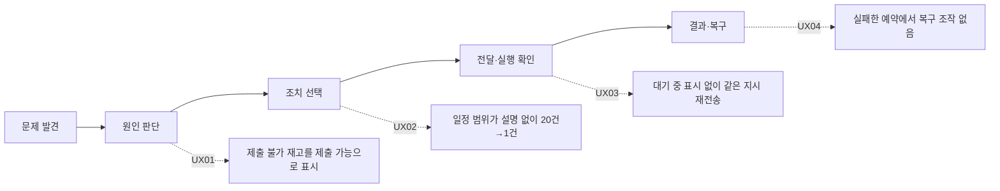

# UX 혹평 — REWORK_REQUIRED

**8개 핵심 과업 중 8개 심사. P1 4건, P2 3건.** 현재는 상태를 열람할 수 있지만, 재고의 의미·일정 범위·실패 복구에서 운영 판단을 잘못 이끄는 결함이 있다.

UX 전후: 해당없음 — 제품 코드 수정 금지로 위임받은 독립 혹평이며, 기존 화면을 수정하거나 새 화면을 만들지 않았다.

| 심각도 | ID | 결함 | 근거 종류 |
|---|---|---|---|
| P1 | UX01 | 제출 대상이 아닌 재고의 상태가 `제출 가능` | 실데이터 + UI 재현 |
| P1 | UX02 | 전역 일정이 직전 선택 계정에 조용히 종속 | UI 재현 |
| P1 | UX03 | 지시 대기 상태가 계정에 남지 않고 동일 지시를 연속 적재 | 격리 API + UI 재현 |
| P1 | UX04 | 실패한 예약이 이유·재시도·정리 없이 남음 | 실패 상태 주입 + UI 재현 |
| P2 | UX05 | 로그인 등 조치의 선행 조건을 실행 확인창에서야 설명 | 실상태 + 화면 관찰 |
| P2 | UX06 | 다른 화면을 보러 가면 재고 탐색 맥락을 잃음 | UI 재현 |
| P2 | UX07 | 모바일 토스트가 주 행동 위에 뜨고 터치를 가로챔 | hit test + 실제 클릭 재현 |

P1은 일상 운영 전에 고칠 문제, P2는 반복 사용과 복구 품질을 떨어뜨리는 문제로 평가했다. 재현하지 않은 실제 원본 자동화의 결과나 실제 사용자 행동을 주장하지 않는다.

## UX01 · 제출할 수 없는 그림이 `제출 가능`이라고 나온다

| 항목 | 판단 |
|---|---|
| 관측 | 심사 시 스냅샷에서 `eligible=false`이면서 `phase=ready, state=ready`인 재고가 **1,876개**다. `전체`에서 연 `음식 사진 촬영` 8번 재고 상세는 `상태: 제출 가능`과 `계정 배정: 다른 계정 또는 미배정`을 함께 표시한다. |
| 재현 | 재고 → 전체 → `음식 사진 촬영` 검색 → 첫 그림 상세. 캡처의 8번 그림은 실제 데이터에서 `owned=false, eligible=false`다. |
| 사용자 영향 | `제출 가능` 필터의 318개는 실제 자격으로 거르지만, 전체 목록·상세에서는 같은 단어를 제작 완료 상태에 재사용한다. 사용자가 그림 한 개의 제출 자격을 믿고 다음 지시를 정할 수 없다. |
| 원인 | [필터](../../src/ui/Panels.tsx#L130)는 `eligible`을 쓰고, [목록](../../src/ui/Panels.tsx#L433)과 [상세](../../src/ui/Panels.tsx#L1032)는 `state`만 번역한다. [상태 사전](../../src/data.ts#L27)의 `ready`는 `제출 가능`이다. |
| 최소 개선 | 제작 단계와 실제 제출 자격을 구분한다. 자격 미달이면 `제출 제외`와 한 가지 구체적 이유를 먼저 표시한다. 이를 숨기고 `다른 계정 또는 미배정`처럼 두 경우를 한꺼번에 쓰지 않는다. |
| 합격 기준 | `eligible=false`인 모든 그림이 목록·상세에서 무조건적 `제출 가능`으로 표시되지 않는다. `eligible=true`인 그림만 같은 의미의 라벨과 제출 가능 수량에 포함된다. |

스냅샷에 불가 사유가 개별 항목으로 없으므로, 소유·중복·배정·시각 대기 중 정확한 이유를 보여 주려면 데이터 계약도 보완해야 한다. 코드만 보고 실제 사유를 임의로 추정해서 붙이면 안 된다.

## UX02 · 전역 `일정`이 마지막에 본 계정만 보여 준다

| 항목 | 판단 |
|---|---|
| 관측·재현 | 아무 계정을 고르기 전 일정에는 실제 제출·예상 심사가 **20건**이다. 5번 계정 상세를 본 뒤 하단 전역 `일정`을 누르면 **1건**으로 바뀐다. 제목은 계속 `출하 일정`이고 계정 필터 표시·전체 보기 조작이 없다. |
| 사용자 영향 | 12개 계정의 일정을 없는 것으로 오해하거나, 마지막 선택 계정과 무관한 전체 일정을 확인했다고 생각할 수 있다. |
| 원인 | [전역 일정 버튼](../../src/App.tsx#L438)은 선택 계정을 지우지 않고, [달력](../../src/ui/Panels.tsx#L532)은 그 선택으로 필터링한다. 재고에는 범위 표시·전체 보기가 있지만 일정에는 없다. |
| 최소 개선 | 전역 메뉴에서 들어오면 전체 범위를 보여 준다. 계정에서 들어오는 일정은 상단에 `5번` 범위와 `전체` 전환을 짧게 유지한다. |
| 합격 기준 | 어느 계정을 보고 있었든 전역 `일정`의 범위가 동일하다. 특정 계정 일정이면 범위와 해제 조작이 그 자리에서 보인다. |

## UX03 · 지시를 보낸 직후에도 전과 같은 화면이라 다시 보내게 된다

| 항목 | 판단 |
|---|---|
| 관측·재현 | 재확인 → 지시 보내기 후 계정 상세의 상태·다음 확인·버튼이 그대로다. 재확인 버튼은 계속 활성화되어 있고 같은 계정에 같은 지시를 한 번 더 보내면 메모리 DB에 **대기 명령 2개**가 쌓인다. 전달 대기는 별도 `확인할 일`에서만 볼 수 있다. |
| 사용자 영향 | 토스트가 사라지면 요청이 남아 있는지, 실패했는지, 다시 눌러야 하는지 알기 어렵다. 바쁜 운영에서 불필요한 재요청을 유도한다. |
| 원인 | [execute](../../src/ui/Panels.tsx#L84)가 매번 새 `crypto.randomUUID()`를 발급한다. [계정의 재확인 버튼](../../src/ui/Panels.tsx#L831)은 연결 상태만으로 비활성화한다. 동일 ID 재전송에 대한 서버 멱등성 결함으로 분류한 것이 아니다. |
| 최소 개선 | 요청한 계정에서 `지시 대기 → 작업기에 반영 → 실제 확인 완료/실패`를 구분한다. 같은 의미의 대기 지시가 있으면 새 요청 대신 현재 지시를 확인할 수 있게 한다. |
| 합격 기준 | 연속 동일 지시가 의도 없이 늘어나지 않는다. 사용자가 화면을 옮기지 않아도 현재 계정의 지시가 접수·대기·반영·실패 중 어디에 있는지 확인할 수 있다. 설정 반영을 실제 심사·제출 완료로 표시하지 않는다. |

증거: [요청 직후 화면](../../artifacts/review-2026-10-18/ux/04-after-command.png), [대기·실패 화면](../../artifacts/review-2026-10-18/ux/05-command-failed.png), [실행 결과 JSON](../../artifacts/review-2026-10-18/ux/results.json)의 `findings.command`.

## UX04 · 실패한 예약이 영구적인 막다른 곳이다

| 항목 | 판단 |
|---|---|
| 관측·재현 | 격리 DB에 `kind=recheck, status=failed`인 예약을 넣어 새로고침했다. `작업기 재확인 · 처리 실패`만 보이고 해당 행의 버튼은 **0개**다. 취소·완료 기록으로도 이동하지 않는다. 지시 실패에도 재시도 조작은 없다. |
| 사용자 영향 | 무엇을 고친 뒤 다시 예약해야 하는지 모르고, 실패 항목을 처리하거나 정리할 수 없다. 사용자가 새 예약을 만들어도 이전 실패가 해결되지 않은 일처럼 남는다. |
| 원인 | [일정 상태 표시](../../src/ui/Panels.tsx#L499)는 실패 문구만 붙인다. [복구 조작](../../src/ui/Panels.tsx#L508)은 `planned`에만 있다. |
| 최소 개선 | 실패 이유와 `다시 예약`·`기록 닫기` 중 가능한 행동을 같은 행에 둔다. 원본 수정이 선행되어야 하면 그 조건을 표시한다. |
| 합격 기준 | 실패 예약에서 이유를 확인하고, 같은 대상·내용을 유지해 재예약하거나 처리한 기록으로 닫을 수 있다. 일부 항목만 실패했을 때 나머지 일정을 잃지 않는다. |

실패 상태는 검증용으로 주입했다. 실제 원본 자동화를 실패시킨 시험은 하지 않았다.

## UX05 · 무엇을 먼저 해야 하는지보다 `재확인`을 먼저 권한다

| 항목 | 판단 |
|---|---|
| 관측 | 1번 계정은 실제 `login_required`다. 상세는 `vivaldi 로그인 확인`, `계정 로그인을 기다립니다`를 보여 주고 주 행동은 재확인이다. `로그인은 vivaldi 브라우저에서 먼저 마쳐 주세요`는 재확인을 누른 다음 확인창에서 처음 나온다. 실제 5번의 `브라우저를 전면으로 전환하지 못했습니다`도 원인 문장만 있고 조치 조건이 없다. |
| 사용자 영향 | 휴대폰에서 누를 수 있는 재확인이 해결 행동처럼 보이지만, 작업용 컴퓨터에서 먼저 해야 하는 일이 남아 있다. 제품이 자기 화면에서 해결 가능한 일과 외부 조치가 필요한 일을 구별해 주지 않는다. |
| 최소 개선 | 원인 바로 옆에 `작업용 Mac · Vivaldi에서 로그인 → 재확인`처럼 실행 위치와 순서를 두 단계로 표시한다. 실제 원격 해결 기능이 없으면 있는 것처럼 가장하지 않는다. |
| 합격 기준 | 실행 확인창을 열기 전에도 작업 장소·선행 조치·그다음 버튼을 구별할 수 있다. 로그인 미완료 상태에서 재확인만으로 해결된다고 기대하게 하지 않는다. |

증거: [계정 상세](../../artifacts/review-2026-10-18/ux/03-login-required.png), [모바일 확인창](../../artifacts/review-2026-10-18/ux/12-mobile-action-instructions.png), [확인창 문구](../../src/ui/Panels.tsx#L102). 실제 사용자가 잘못 이해했다고 측정한 결과는 아니며, 조치 단서에 대한 전문가 판단이다.

## UX06 · 문제를 확인하러 잠깐 나가면 재고 검색을 다시 해야 한다

| 항목 | 판단 |
|---|---|
| 관측·재현 | 재고 `전체` + 검색 `꽃` = 5개 → 확인할 일 → 재고로 돌아오면 검색은 빈칸, 필터는 `제출 가능`, 결과는 318개로 바뀐다. |
| 사용자 영향 | 재고를 점검하다 오류를 확인하는 자연스러운 업무 전환에서 탐색 맥락을 잃는다. 목록 위치와 조건을 기억해서 다시 입력해야 한다. |
| 원인 | [Panels의 key](../../src/App.tsx#L394)가 화면 종류마다 달라지고 검색·필터·페이지 상태는 컴포넌트 내부에만 있다. |
| 최소 개선 | 핵심 목록의 검색·필터·페이지·스크롤을 화면 간 이동 시 보존한다. 전역 재고 진입에서 범위를 바꾸는 동작과 탐색을 초기화하는 동작을 구별한다. |
| 합격 기준 | 같은 왕복 흐름 후 검색 `꽃`, 필터 `전체`, 결과·목록 위치가 유지된다. 새로 시작하려는 사용자는 명시적 초기화로 전체 탐색을 되찾을 수 있다. |

증거: [실행 JSON](../../artifacts/review-2026-10-18/ux/results.json)의 `findings.navigation`. 그림 상세를 열었다 닫는 동안은 부모 패널이 유지되므로 같은 문제로 묶지 않았다.

## UX07 · 모바일 성공 토스트가 버튼을 가리고 입력도 막는다

| 항목 | 판단 |
|---|---|
| 관측·재현 | 390×844에서 재확인 지시 직후 토스트는 `(97.5,685), 195.08×52`, 재확인 버튼은 `(199,688), 158×44`다. 버튼 중앙 `(278,710)`의 hit target은 `.toast`다. `pointer-events:auto`이며 실제 클릭이 `Timeout 1200ms exceeded`와 `toast ... intercepts pointer events`로 실패했다. 토스트가 사라진 뒤 같은 클릭은 성공했다. |
| 사용자 영향 | 다음 계정·다음 행동을 연속 처리할 때 5초 피드백이 조작을 방해한다. 모바일 핵심 버튼이 화면 안에 있다는 기존 시험만으로는 잡히지 않는다. |
| 원인 | [toast 위치](../../src/style.css#L1444)가 고정 하단 행동 영역과 겹치고 입력을 받는다. |
| 최소 개선 | 알림을 고정 행동 영역 위로 배치한다. 상호작용 없는 알림은 입력을 가로채지 않게 한다. |
| 합격 기준 | 토스트가 보이는 동안에도 현재 화면의 주 행동 라벨이 가리지 않고, 버튼 중앙 실제 터치가 해당 버튼에 전달된다. 작은 화면·큰 글자에서도 겹치지 않는다. |

증거: [hit test JSON](../../artifacts/review-2026-10-18/ux/toast-hit-test.json). 문서의 오류 원문은 1,200ms 제한의 재현 결과이며, 앱이 영구적으로 멈춘다는 뜻은 아니다.

## 실행 범위와 남는 한계

| 과업 8개 | 확인 결과 |
|---|---|
| 문제 발견·우선순위 | 실데이터의 로그인 1건·작업 막힘 2건·작업기 대기 1건 확인. 해결 순서의 근거는 별도 없음. |
| 원인 판단·조치 선택 | 계정 원인과 재확인 선행 조건 확인. UX05 발견. |
| 지시 대기·실패·결과 확인 | 격리 DB에서 2개 대기 명령·실패 표시 확인. UX03 발견. 실제 작업 완료는 실행하지 않음. |
| 실제 재고와 비대상 구분 | 필터·전체·그림 상세 확인. UX01 발견. |
| 계정에서 일정 진입 | 전체 20건과 계정5의 1건 비교. UX02 발견. |
| 일정 실패·취소 복구 | HTTP 503 시 입력과 날짜 유지 확인. 작성 중 닫고 다시 열면 내용은 사라짐. 실패 예약 복구는 UX04. |
| 검색·목록 복귀·맥락 보존 | 화면 왕복 재현. UX06 발견. |
| 모바일 조작·필수 정보 | 390×844와 768×1024 렌더 확인. 가로 넘침 없음. 고정 주 버튼 44px. 모바일 창고 열기 32px 높이이며 44px 제품 목표에는 미달하지만 이를 곧바로 WCAG 위반으로 판정하지 않음. UX07 실제 hit test 완료. |

- 브라우저: Playwright WebKit headless. PC 1440×900, 모바일 390×844, 태블릿 768×1024. 물리 기기·가상 키보드·스크린리더·전체 WCAG 적합성은 이 심사 범위에서 확인하지 않았다.
- 실서버는 `GET /api/world`, `GET /api/thumbnail/*`만 사용했다. 나머지 `/api/**`는 메모리 SQLite와 원본 API 함수로 인터셉트했다. **운영 API 쓰기 0회**, 실자동화 지시·실일정 저장·로그인·배포 없음. 계정 이메일은 캡처 전에 대체했다.
- 8/8 과업 실행에서 `pageerror` 0건. 검증용 실패 응답·실패 예약은 원본 업무의 실제 실패율을 뜻하지 않는다. 브라우저 전부 종료했다.
- 제품 파일 수정 없음. 이 심사는 요청받은 혹평이며, 개선 구현·전후 보드는 만들지 않았다. 따라서 `UX_AUDITED`나 수정 완료로 판정하지 않는다.

`files_read`: `src/App.tsx`, `src/ui/Panels.tsx`, `src/ui/Primitives.tsx`, `src/data.ts`, `src/types.ts`, `src/style.css`, `connector/bridge.py`, `worker/index.mjs`, `tests/world.e2e.ts`, `tests/db.mjs`, `package.json`의 과업 관련 범위. UX 스킬·ux-playbook·ux-methods·design-taste·headless 실행 지침도 적용했다.

`commands_run`: `python3 ~/.local/bin/codenav map`, `codenav outline`(TSX 심볼 없음으로 필요한 줄 범위를 직접 읽음), `python3 ~/.agents/work-methods/readiness.py show --brief ux`, `node artifacts/review-2026-10-18/ux/audit.mjs`, `node artifacts/review-2026-10-18/ux/toast-hit-test.mjs`, 로컬 Node fetch 읽기 확인. 첫 브라우저 실행은 알림 버튼 접근성 이름에 배지 숫자가 포함된 점 때문에 검증 선택자를 고친 뒤 재실행했으며, 최종 8/8 결과만 판정 근거로 삼았다.

산출물: [주 검증 스크립트](../../artifacts/review-2026-10-18/ux/audit.mjs), [결과 JSON](../../artifacts/review-2026-10-18/ux/results.json), [토스트 재현 스크립트](../../artifacts/review-2026-10-18/ux/toast-hit-test.mjs), [토스트 결과](../../artifacts/review-2026-10-18/ux/toast-hit-test.json), 동일 폴더 PNG 14개. 제품 코드 수정 금지 범위 때문에 개선은 미실행이다.
