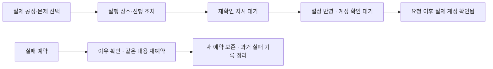

# UX 독립 재심

**검토한 핵심 UX 동작 범위 승인. 6개 과업 중 6개 실행, 검증 27개 중 27개 통과.** 기존 UX01~07의 잘못된 표시·범위·재요청·복구·맥락·입력 차단 반례가 수정됐다. 상용 경영 게임급 시각 완성도·물리 기기·실제 원본 작업 결과·장기 재방문의 재미까지 이 결과로 승인하지 않는다.

UX 전후: 해당없음 — 독립 심사자로 제품 파일을 수정하지 않았다. 최초 혹평의 캡처와 이번 실제 실행 캡처를 대조했으며, 시점·시험 데이터가 달라 임의의 시각 개선 점수나 판단 시간은 계산하지 않았다.

| 기존 지적 | 재심 결과 | 근거 |
|---|---|---|
| UX01 제출 불가 재고를 제출 가능으로 표시 | 표시 모순 해소. 타계정·소유했지만 비대상인 두 그림 모두 목록·상세 `제출 제외` | [상세](../../artifacts/recheck-ux/06-excluded-detail.png), JSON 검증 11~12 |
| UX02 전역 일정의 숨은 계정 범위 | 계정5를 보던 상태에서 전역 일정은 `모든 작업동`, 실제 제출 이력 3계정 모두 표시 | JSON 검증 13~14. 다음 제출 계획 13행과 실제 제출 이력 3행을 구별해 계수 |
| UX03 지시 대기 피드백·연속 재요청 | 대기 버튼 비활성, 메모리 DB 명령 1개. 반영 전후와 실제 계정 확인을 같은 상세에서 구별 | [대기](../../artifacts/recheck-ux/03-command-queued.png), [반영·관측 전](../../artifacts/recheck-ux/04-applied-awaiting-observation.png), [관측 후](../../artifacts/recheck-ux/05-after-actual-observation.png) |
| UX04 실패 예약의 복구 단절 | 실패 메시지·재예약·기록 닫기 제공. 저장 503에서 초안 보존, 새 예약과 과거 실패 기록 동시 보존, 과거 실패는 cancelled로 정리 | JSON 검증 16~20. 취소 직후 캡처는 렌더 반영 전이므로 최종 UI 정리 증거로 사용하지 않음 |
| UX05 조치 선행 조건을 확인창에서만 설명 | 계정 상세에 `운영 맥의 vivaldi 브라우저에서 … 로그인한 뒤 재확인`을 먼저 표시 | JSON `recoveryBeforeAction`, [대기 캡처의 원인 영역](../../artifacts/recheck-ux/03-command-queued.png) |
| UX06 재고 왕복의 탐색 맥락 소실 | 검색 `UX 재고`, 전체 필터, 2/3페이지, 스크롤 220px가 모두 그대로 유지 | [왕복 후](../../artifacts/recheck-ux/07-inventory-preserved.png), JSON `inventoryRoundTrip` |
| UX07 모바일 토스트가 주 행동 입력 차단 | 390×844에서 토스트 `pointer-events:none`, 버튼 중앙 hit test 정상. 토스트가 보이는 동안 일정 추가 실제 클릭 성공 | JSON `mobileToast`, 검증 26~27 |

## 이번에 실제로 실행한 6개 과업

| # | 실행과 확인 결과 |
|---|---|
| 1 · 장면 병목·계정 | 실제 공정 4개와 계정 13개 표식을 확인. 검수 선택→내부 검수·메타데이터 상세, 비축 선택→실제 제출 가능 그림. 내부 검수를 외부 제출 심사로 부르던 수정 중 혼동도 `검수소`로 해소됨. |
| 2 · 복구→지시→관측 | 로그인 원인 확인→지시 1회→대기 차단→격리 설정 반영→`지시 이후 계정 확인 대기`→격리 새 checkedAt 수신→`지시 이후 계정 확인됨`. 실제 제출 성공을 모의로 승인한 시험이 아님. |
| 3 · 재고 자격 | 타계정 그림·소유했지만 비대상인 그림의 제외 필터/목록/상세 확인. ready 단계만으로 제출 가능으로 번역하지 않음. |
| 4 · 범위·탐색 | 계정5→전역 일정 전체 범위, 실제 이력 3건 확인. 재고 검색·전체·2/3페이지·220px 스크롤→확인할 일→재고 왕복 보존. |
| 5 · 실패 예약 | 실패 원인 확인→재예약의 계정5·제목 보존→HTTP 503 초안 보존→정상 저장→실패 기록과 새 planned 예약 2개 보존→과거 기록 cancelled 확인. |
| 6 · 변화·관측·모바일 | 다음 제출/20·20 한도/3일 전 관측과 오래됨 표시 확인. 최근 실제 공개 1건을 주입→최근 변화 1건→확인 기준 저장→이력 클릭에서 해당 계정. 원본 업로더 시각만 오래되게 만들면 fresh 연결이어도 `제출 작업기 확인`. 모바일 토스트 중 주 행동 실행. |

27개 검증의 개별 결과는 [results.json](../../artifacts/recheck-ux/results.json)에 있다. `pageerror` 0개. 같은 동작을 실제 운영 API로 보내지는 않았다.

## 승인에 포함하지 않는 부분

- **개별 제출 제외 사유의 세분화:** `owned=false`는 계정 배정 확인으로 설명한다. `owned=true, eligible=false`는 여전히 배정·중복·시간 대기 중 어느 것인지 합친 문구다. 거짓 `제출 가능` 표시는 해소됐지만 정확한 원인별 복구까지 해결됐다고 보지 않는다. 현재 데이터 계약에 개별 사유가 없다.
- **상용 게임급 공간의 식별성·마감:** 실제 썸네일과 화풍 약칭이 추가됐다. 최신 표현은 정상 계정 약칭을 상시 숨기고 작은 썸네일을 우선한다. 계정 표식이 13개라는 검증은 사람이 목표 화풍을 즉시 알아본다는 측정 결과가 아니다. 최종 장면 축척·에셋·배치와 전환은 UI·게임·Three.js의 최신 렌더 심사를 함께 따른다.
- **최종 크기 변경 캡처:** `10-tablet-overview.png`는 viewport 변경 직후 3D 재구성 전 프레임이어서 시각 승인 근거에서 제외했다. 이전 제작자의 6개 크기 렌더는 참고했지만 이를 내가 동일 조건에서 실행한 최종 기기별 검증으로 포장하지 않는다. 물리 기기·가상 키보드·스크린리더·전체 WCAG 적합성·장기간 사용은 미검증이다.
- **실원본 결과:** 모의 `applied`와 새 계정 관측을 순서대로 넣어 UI 연결을 검증했다. 원본 자동화가 실제로 계정을 확인하거나 제출했음을 증명하지 않는다. 공개 HTTPS·Cloudflare·상시 연결 설치도 범위 밖이다.

재심 중 비축 시설 선택 후 계정을 골라도 두 선택 강조가 함께 남는 P2를 전달했다. 이후 `App.select`의 `setActiveProcess(null)` 수정은 소스에서 확인했다. 이 한 줄 이후의 실제 렌더 회귀는 root의 최종 화면 검증과 합쳐 판정한다.

## 실행 기록

- 대상: 최종 핵심 UI가 반영된 로컬 배포형 `http://127.0.0.1:4317`. Playwright WebKit headless 1개. 1440×900의 핵심 과업, 390×844의 토스트 입력 검증. 768×1024는 위의 안정화 전 캡처 제한을 적용했다.
- 실제 서버 사용: 최초 `GET /api/world`, 썸네일 GET만. 그 외 `/api/**`는 모두 메모리 DB와 실제 Worker API 함수로 인터셉트했다. **운영 쓰기 0회**, 실일정·실명령·배포·인증 변경 0회. 캡처 전에 계정 이메일을 대체했다. 브라우저 종료·슬롯 반환 완료.
- `files_read`: `src/App.tsx`, `src/data.ts`, `src/types.ts`, `src/ui/Panels.tsx`, `src/ui/Primitives.tsx`, `src/ui/Panels.css`, `src/style.css`, `src/world/World.tsx`, `src/world/World.css`, `src/world/layout.ts`, `worker/schema.sql`, 기존 시험의 관련 범위. 기존 UX·고객·목적·게임 보고와 `repair-ux-direction.md`, 제작자의 최신 6크기 렌더도 대조했다.
- `commands_run`: codenav map, 관련 소스 범위 조회, `node --check artifacts/recheck-ux/check.mjs`, `node artifacts/recheck-ux/check.mjs`. 첫 실행에서 새 DOM에 맞지 않은 3개 선택자를 정정했다. 그 결과는 `first-results.json`에 보존했고 앱 결함이나 최종 통과로 세지 않았다. 최종은 **6/6·27/27**, 오류 0개다.
- 증거: [재현 스크립트](../../artifacts/recheck-ux/check.mjs), [최종 결과](../../artifacts/recheck-ux/results.json), 같은 폴더의 핵심 상태 캡처. 제품 코드 변경 없음. 이 보고서와 검증 산출물만 작성했다.

**판정 범위:** 상태·자격을 믿고 다음 행동을 정하고, 지시와 실제 관측을 구별하고, 목록 왕복과 실패에서 복구하는 확인한 UX 동작은 승인한다. 원래 요청 전체의 상용 품질 완료 선언은 별도 최종 시각·게임·실환경 검증 결과를 합쳐야 한다.
