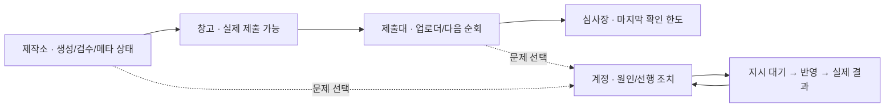

# UX 수정 방향 · 구현 후 독립 재심사

**핵심 흐름: 장면에서 막힌 곳 선택 → 원인과 선행 조치 → 한 번 지시 → 같은 대상에서 결과 확인.** 기존 UX01~07, 고객 C01~08, 목적 심사의 근거를 재사용한다. 새 메뉴·장식·설명 문단으로 해결하지 않는다. 현재 판정은 미정이다.

UX 전후: 해당없음 — 이 문서는 수정 방향과 재심사 기준이며 제품 화면을 수정하지 않았다. 구현 후 같은 조건의 전후 캡처와 실제 과업 결과로 판정한다.

| 화면 요소 | 구현할 최소 형태와 클릭 결과 |
|---|---|
| 상시 HUD | 연결 신호+마지막 수신, **내 개입 N**, 확인 전 실제 변화 `+N`만 한 줄. 작업기 자동 복구 대기를 내 개입과 구별한다. 정상·문제는 색과 함께 잠금/경고/작업 중 형태로 구별한다. 모바일에서도 숫자의 의미를 아이콘 추측에 맡기지 않는다. |
| 공정 시설 | 제작소·창고·제출대·심사장을 실제 원본 공정에 대응시킨다. 각 시설에는 짧은 이름과 지금 필요한 상태 하나만 표시한다. 제작소→해당 작업기 상태, 창고→`제출 가능` 그림, 제출대→업로더 상태·다음 순회, 심사장→`심사 중` 그림. 날짜는 그 상세의 일정 진입으로 제공한다. 기존 메뉴·2D 공정 바가 같은 일을 중복하면 덜어낸다. |
| 장면의 움직임 | 실제 실행/전달 중인 공정만 움직인다. 연결 프로그램의 최근 수신만으로 원본 작업기까지 정상·작업 중으로 표시하지 않는다. 정보가 오래되면 시설도 `확인 필요`다. 확보하지 않은 진행률·생산량·결과를 추정해 연출하지 않는다. |
| 계정별 식별 | 실제 대표 제작물 작은 썸네일+2~4자 화풍 약칭+번호를 같은 선택 표식에 둔다. 목표는 번호 암기 없이 계정을 찾는 것. 선택·문제 계정만 원인/긴 이름을 확장하고, 전체 시점에서는 13개 표식의 겹침과 클릭 위치를 확인한다. 색깔 건물만 늘려 구별하는 것으로 끝내지 않는다. |
| 계정 상세의 첫 화면 | 맨 위에 원인과 실행 장소·선행 조치, 바로 아래 실제 가능 재고/마지막 확인 심사 자리/다음 제출 예정. `운영 Mac · Vivaldi 로그인 → 재확인`처럼 필요한 순서만 둔다. 주 행동은 선행 조치 뒤 `재확인`; 요청 후 같은 자리는 `지시 대기`와 결과로 바뀐다. 자동 설정 반영과 실제 심사·제출 완료를 분리한다. |
| 다음 제출·심사 한도 | `next_upload_on`이 있으면 `다음 제출 예정`으로, 재확인 예약은 `재확인`으로 구별한다. 일정이 없거나 심사 자리를 모르면 `미확인`. 예: `심사 20/20 · 10/15 확인`은 관측값이며 현재 확정 한도로 말하지 않는다. 오래된 값과 막힘 조건이 예정 날짜보다 우선한다. |
| 재고·필터 | `eligible`을 목록·상세·집계에 같은 의미로 적용한다. `eligible=false`는 `제출 제외`+실제 한 가지 이유. 제작 완료 상태와 제출 자격을 혼용하지 않는다. 전역 재고/일정은 전체, 계정에서 진입하면 `5번 ×` 범위를 보이며 해제 가능. 검색·필터·페이지·스크롤은 화면 왕복에서 보존한다. |
| 실패 예약 | 실패 행에 실제 이유, `다시 예약`, `기록 닫기`를 제공한다. 재예약은 대상·내용을 보존하고 새 시각만 정한다. 원본 수정이 선행되면 그 조건을 먼저 표시한다. 다른 정상 일정·실패 이력은 잃지 않는다. |
| 직전 방문 이후 변화 | 최초 성공 수신 시 이전에 확인한 기록 ID/시각을 읽고 세션 중 기준을 고정한다. 실제 새 제출·공개·문제 해소를 해당 시설/계정에 `+1`로 연결하고, 눌러 짧은 최근 기록을 본 뒤 확인 기준을 갱신한다. 첫 방문은 `최근 기록`, 이력 범위가 끊겼으면 `최근 N건 기준`; 전체 기간 변화량인 것처럼 말하지 않는다. 단순 현재 수량의 증감만으로 성공을 추정하지 않는다. |
| 작은 화면 | 고정 주 행동·메뉴는 화면 안에 둔다. 토스트는 주 행동 위 다른 영역에 배치하고 입력을 가로채지 않는다. 패널은 원인·판단 수치·행동을 먼저, 최근 제작물·목표 상세는 아래에 둔다. 모바일·태블릿 세로와 PC 세로도 같은 과업 순서다. |

**재심사할 과업은 6개다.** 운영 쓰기는 격리 DB에서만 실행하고, 실제 제출 성공·물리 기기 사용성은 별도로 확인한 범위만 주장한다.

| # | 반드시 끝까지 실행할 과업 | 합격 근거 |
|---|---|---|
| 1 | 첫 장면에서 실제 병목 시설과 목표 화풍 계정 찾기 → 선택 | 시설이 실제 원본 상태와 맞음. 번호 암기·색만으로 찾지 않으며, 클릭한 공정/계정과 열린 상세가 일치. |
| 2 | 로그인/막힘 계정 → 선행 조치 판단 → 재확인 → 대기/반영/실제 확인 또는 실패 | 같은 의미의 지시가 의도 없이 2개 쌓이지 않음. 계정 안에서 상태를 끝까지 구별. 토스트 중 주 행동 hit test도 통과. |
| 3 | 실제 가능/다른 계정 소유/중복·배정·시간 대기/보류 그림을 목록·상세에서 비교 | 자격 없는 그림에 무조건적 `제출 가능`이 없고 이유가 원본과 일치. 집계와 그림 목록이 같은 시점·범위. |
| 4 | 계정5 상세 → 전역 일정 → 계정 일정/전체 전환 → 재고 검색·다른 화면 왕복 | 전역 전체 범위가 일관됨. 계정 범위와 해제 조작이 보임. 검색·필터·페이지·스크롤 보존. |
| 5 | 예약 저장 오류 → 입력 보존·재시도 → 실패 예약의 이유 확인·다시 예약·기록 닫기 | 대상·작성 내용·다른 일정 보존. 실패에서 닫힌 복구 경로와 저장된 결과 확인. |
| 6 | 다음 제출·심사 한도·관측 시각 판단 → 이전 방문 이후 새 공개/제출/문제 해소 주입 → 재진입 | 예정과 확정·과거 관측·미확인 구별. 실제 변화가 해당 시설/계정에서 보이며 중복 집계·가짜 성과 없음. 원본 작업기 정지 시 연결 수신만으로 정상 표시되지 않음. |

6개 과업의 대표 상태를 390×844·768×1024·1440×900에서 확인하고, 900×1440·844×390에서는 전체 단지/메뉴/주 행동이 실제 보이고 눌리는지 추가 확인한다. 이는 전문가 실행 기준이며 사람의 이해 시간·재방문 재미를 임의 점수로 바꾸지 않는다.
